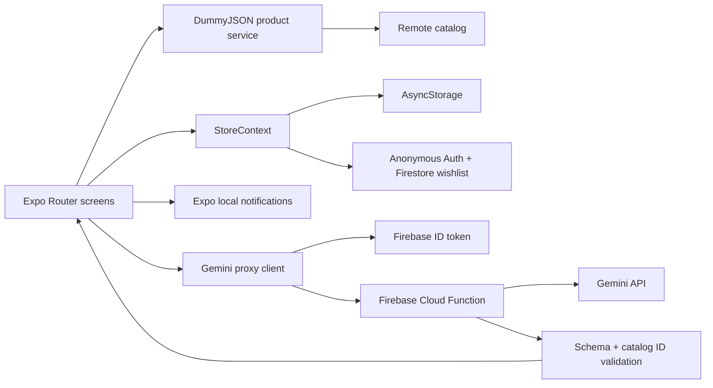

# Assignment 2 Evidence Pack

Trạng thái được ghi theo lần kiểm tra trong workspace; `Pending` nghĩa là chưa chạy trên Android/device hoặc chưa có credential, không phải pass.

## 1. Requirement Traceability Matrix

| ID | Yêu cầu | Bằng chứng trong project | Test / trạng thái |
| --- | --- | --- | --- |
| R01 | Remote product data | `src/services/products.js` | API success/error: pending device/network test |
| R02 | FlatList + pagination | `src/app/(tabs)/index.js` | load more/end/duplicate guard: pending device test |
| R03 | Search/category/refresh | Discover screen + products service | hit/miss/refresh: pending device test |
| R04 | Product detail | `src/app/product/[id].js` | valid/missing ID: pending device test |
| R05 | Cart add/update/remove | StoreContext + `src/lib/cart.mjs` | unit tests pass; device flow pending |
| R06 | Derived totals/count | `getCartSummary` | 0/1/multiple products: unit test pass for multi-item; empty and single UI pending |
| R07 | Persistence | AsyncStorage in StoreContext | restart: pending device test |
| R08 | Firebase business use case | Firebase anonymous Auth, Firestore wishlist, `firestore.rules` | config/write/read/error: pending Firebase project |
| R09 | Notification flow | notification service + Settings + cart event | permission allow/deny: pending Android device |
| R10 | Gemini business integration | Studio UI + authenticated Cloud Function | valid/invalid/timeout: pending deploy + secret |
| R11 | Debug evidence | Section 5 below | two integration/debug investigations recorded; live app bug logs still need student evidence |
| R12 | Android release | `eas.json` preview APK profile | build/install/run: pending EAS project/credentials |

## 2. Workflow and Integration Map

## 3. Design Decision Record

| Quyết định | Lựa chọn | Lý do / trade-off | Nếu requirement đổi |
| --- | --- | --- | --- |
| Navigation | Expo Router, tabs + dynamic product route | File-based cross-platform navigation; routes chia nhỏ để demo | Thêm route, deep link và test route tương ứng |
| State | Context API cho cart/favorites | Quy mô assignment vừa phải, shared state đơn giản | Nhiều workflow/account có thể chuyển sang Redux Toolkit |
| Catalog | DummyJSON page-number API | Không cần backend riêng; pagination/search/category minh bạch | Đổi service adapter nếu chuyển sang cursor/lecturer API |
| Pagination | limit/skip, in-flight guard, ID dedupe, abort request cũ | Ngăn request trùng khi scroll/filter | Cursor API sẽ thay skip/total và end condition |
| Persistence | AsyncStorage cart/favorites; Firebase wishlist sync | Offline-first, core flow không phụ thuộc mạng | SQLite nếu cần query/cache lớn; conflict policy nếu multi-device |
| Cart totals | Derive từ `items[].price * quantity` | Tránh stale duplicated total | Thêm discount/tax ở selector, không sửa source state |
| Firebase | Anonymous Auth + `/users/{uid}/wishlist/{productId}` | Có business record, UID isolation trong rules | Thêm profile/account migration nếu có đăng nhập thật |
| Gemini | Cloud Function secret + Firebase ID token + structured JSON | Không lộ API key; request có catalog context và server/app validate IDs | Thay schema/prompt ở function và cập nhật tests/client contract |
| Notification | Local notification trên cart.added; permission request chủ động trong Settings | Có business event và deny path, không cần push server | Push cần device token registration/backend và EAS credentials |
| Release | EAS preview APK + production AAB | Không cần giữ native folders trong source | Liên kết EAS project, credentials, env và build artifact |

## 4. Test Matrix (15 cases)

| # | Nhóm / case | Thao tác | Kết quả mong đợi | Trạng thái hiện tại |
| --- | --- | --- | --- | --- |
| 1 | API success | Mở Discover khi online | Catalog hiển thị | Pending device test |
| 2 | API network error | Tắt mạng rồi retry | Error feedback, app không crash | Pending device test |
| 3 | Empty list | Dùng query không khớp | Empty state, không render lỗi | Pending device test |
| 4 | Pagination end | Scroll tới cuối | Không request lặp vô hạn/duplicate item | Pending device test |
| 5 | Search/category/refresh | Search hit/miss, chọn category, kéo refresh | Kết quả khớp, refresh trang đầu | Pending device test |
| 6 | Cart add same item | Add cùng product hai lần | Quantity 2, total đúng | Unit test pass; UI pending |
| 7 | Cart quantity 0/remove | Decrease về 0 hoặc remove | Item bị xóa | Unit test pass; UI pending |
| 8 | Persistence | Thêm item rồi restart | Cart/favorite được restore | Pending device test |
| 9 | Firebase write/read | Save favorite và mở lại | Wishlist có record đúng UID | Pending project config |
| 10 | Firebase error | Deny rules/offline | Favorite vẫn local, có feedback | Pending project config |
| 11 | Notification denied | Deny permission | App còn dùng được, status rõ | Pending Android device |
| 12 | Notification allowed/event | Cho phép rồi add item/test | Notification xuất hiện | Pending Android device |
| 13 | Gemini valid | Gửi nhu cầu có context catalog | Summary và product tồn tại được render | Pending function/secret |
| 14 | Gemini invalid/error | Trả ID giả, timeout hoặc JSON sai | Không render ID lạ, có fallback | Client/server validation implemented; runtime test pending |
| 15 | Release | Build APK, install và chạy core flow | App chạy ngoài dev server | Pending EAS credentials |

### Automated evidence

`npm test`: 4 tests pass. `npx expo export --platform web`: pass. `npx expo export --platform android`: pass. `node --check functions/index.js`: pass. Các lệnh này không thay thế permission, Firebase, Gemini, device hoặc EAS runtime tests.

## 5. Debug Log

| Lỗi quan sát được | Giả thuyết | Cách kiểm tra | Root cause | Fix | Retest |
| --- | --- | --- | --- | --- | --- |
| `npm install firebase` thất bại `ERESOLVE`; resolver chọn React DOM 19.3.1 | Peer dependency lệch Expo SDK | So sánh React/React DOM package versions, dùng `npx expo install` | Expo SDK 57 đang dùng React 19.2.3 | Cài `react-dom` bằng Expo installer, sau đó pin Firebase 12.10 cho Node 22 | `npx expo install --check` pass; web export pass |
| Firebase adapter check trên Node trả `getReactNativePersistence: undefined` | API có thể thiếu trong Firebase release | So sánh `@firebase/auth` package conditions và `dist/rn` entry | Node resolver đọc node/web export; Metro Android dùng `react-native` export riêng | Native gọi `initializeAuth` với RN persistence; web dùng `getAuth` | Android bundle pass; cần xác minh restore thật trên device |

Hai mục trên là integration/debug findings trong quá trình dựng project. Chúng chưa phải hai live app defects quan sát trên thiết bị; trước buổi chấm, ghi thêm ít nhất hai lỗi app thật với triệu chứng, log/screenshot, root cause và retest của chính bạn.

## 6. AI Usage Log

| # | Task / prompt summary | Mục đích | Output dùng? | Đã chỉnh | Kiểm chứng |
| --- | --- | --- | --- | --- | --- |
| 1 | Dùng Student Guide để scaffold integrated Expo shop | Tạo vertical slices phù hợp rubric | Có, làm bản khởi tạo | Dùng JavaScript/Expo SDK 57, thêm state/services, không đưa credentials vào source | 4 unit tests; web và Android JS bundle |
| 2 | Thiết kế Gemini recommendation/compare có validation | Gắn AI với catalog business context | Có, làm client + Firebase Function | Proxy server giữ secret; Firebase ID token; structured output; lọc IDs hai phía | Syntax check, web/android bundle; model call chờ cấu hình |
| 3 | Gợi ý RTM/test matrix/security/release documentation | Chuẩn bị evidence theo checklist | Có | Trạng thái pending giữ nguyên khi chưa có device/credentials/build | Đối chiếu code, lệnh build/test đã chạy và yêu cầu trong guide |

## 7. Transfer Practice

| Change request | Screen/state/service | Thay đổi dự kiến | Test cần thêm |
| --- | --- | --- | --- |
| Sort by price | Discover, query state, product list selector | Thêm segmented sort; sort displayed page hoặc chuyển sort vào API strategy; không sửa catalog source | Ascending/descending, category/search kết hợp, pagination không duplicate |

## 8. Submission items to finish

- Điền student name/class và xác nhận project naming convention với lớp.
- Cấu hình Firebase, deploy rules/function, chạy read/write và permission/error cases.
- Cấp Gemini secret, chạy valid/invalid/timeout cases.
- Ghi hai debug logs từ app thật và retest.
- Chạy toàn bộ manual matrix trên Android emulator/device.
- Tạo APK/AAB, install/run, đính kèm artifact/build evidence.
- Thêm screenshots/logs và cập nhật trạng thái các hàng `Pending`; không đánh dấu pass nếu chưa chạy.